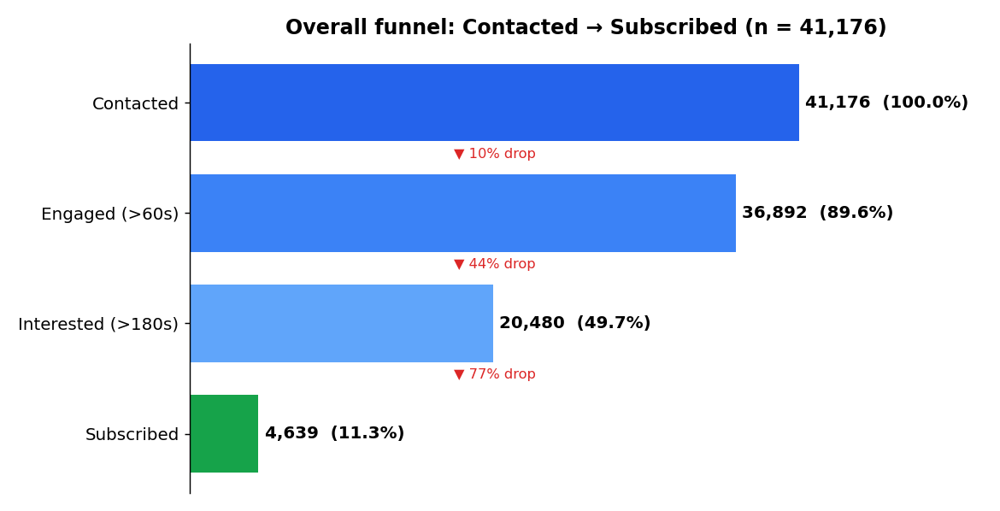

# FUTURE_DS_03 – Marketing Funnel & Conversion Performance Analysis

> Where do prospects drop out of the funnel, which channels and segments bring high-quality leads, and how can conversion improve?

An end-to-end funnel analysis of **41,176 bank telemarketing contacts** (term-deposit campaign, 2008–2010) with an interactive dashboard, a written report and actionable recommendations.

**Dashboard:https://pranavshelar20.github.io/FUTURE_DS_03/dashboard/
**Full write-up:** [`REPORT.md`](REPORT.md)

## Headline results

| Stage | Contacts | % of contacted | Step drop-off |
|---|---|---|---|
| Contacted | 41,176 | 100% | – |
| Engaged (call > 60 s) | 36,892 | 89.6% | 10.4% |
| Interested (call > 180 s) | 20,480 | 49.7% | 44.5% |
| **Subscribed** | **4,639** | **11.3%** | **77.4%** |



## Key insights
- **Cellular beats landline 2.8x** (14.7% vs 5.2% conversion; ~16 vs ~55 calls per sale).
- **Warm leads are gold:** previous-success customers convert at **65%** (5.8x average) – 3% of contacts, 19% of sales.
- **Over-calling wastes effort:** contacts with 5+ attempts used **38% of calls for 6.6% of sales**.
- **Underserved high-intent segments:** students (31%), retirees (25%), <25 and 65+ convert at 2–4x average yet are a small share of calls.
- **Macro context matters:** conversion is ~4x average when Euribor < 1%.
- **Biggest leaks:** Engaged → Interested (44% drop) and Interested → Subscribed (77% drop).

## Recommendations
1. Make cellular the primary channel.
2. Cap attempts at 3–4 per lead; redeploy calls to fresh/warm leads.
3. Call previous-success customers first.
4. Target students, retirees, <25 and 65+ with tailored offers.
5. Improve opening scripts / value hook to reduce early drop-off.
6. Add follow-up and objection handling to close interested prospects.
7. Time campaigns and messaging to the interest-rate environment.

## Project structure
```
FUTURE_DS_03/
├── data/raw/            original UCI bank-additional-full.csv + data dictionary
├── data/processed/      cleaned & feature-engineered dataset
├── src/
│   ├── 01_clean.py          cleaning + funnel stage flags
│   ├── 02_analysis.py       funnel, segment tables, charts
│   ├── 03_build_dashboard.py + dashboard_template.html
├── outputs/charts/      12 PNG charts
├── outputs/tables/      CSV tables (funnel, channel, month, job, age, attempts ...)
├── dashboard/           interactive HTML dashboard (+ data.json)
├── REPORT.md            full findings
├── LINKEDIN_POST.md     post draft
└── run_all.sh
```

## Methodology
1. **Cleaning:** removed 12 exact duplicates (41,188 → 41,176); no nulls; kept `unknown` as a category; `pdays=999` converted to a `previously_contacted` flag.
2. **Funnel proxy:** the data has no web-traffic/lead stage, so stages use call engagement: Contacted → Engaged (>60 s) → Interested (>180 s) → Subscribed.
3. **Comparison:** conversion, lift vs average, calls per conversion and share of contacts vs share of sales by channel, month, weekday, job, age, education, prior outcome, attempt count, year and Euribor band.
4. **Time period:** the source rows are chronological, so the year was inferred from month wrap-arounds (2008–2010).

## Caveats
- Funnel stages are a proxy; call duration is only known after the call, so it is diagnostic rather than a targeting variable.
- Month, year and interest rate are confounded – seasonality is not causal.
- Results are associations; validate with A/B tests before scaling changes.

## Reproduce
```bash
pip install -r requirements.txt
./run_all.sh
```

## Tools
Python (pandas, NumPy, Matplotlib), Chart.js for the dashboard, HTML/CSS.

## Data source
Moro, Cortez & Rita (2014), *A Data-Driven Approach to Predict the Success of Bank Telemarketing*, UCI Machine Learning Repository.
